<picture>
  <source media="(prefers-color-scheme: dark)" srcset="assets/banner-dark.svg">
  
</picture>

# Evan Hendra

Offensive security. 32 accepted bug bounty findings, 11 of them CVEs in Keycloak.

## Keycloak CVEs

Reported to the Keycloak project and assigned by Red Hat, the CNA. Nine of them ship with a before/after proof of concept in [keycloak-security-research](https://github.com/muff1nmigi/keycloak-security-research): the script prints `VULNERABLE` on the affected release and `FIXED` on the patched one.

| CVE | Issue | CVSS 3.1 | PoC |
|---|---|---|---|
| [CVE-2026-4636](https://access.redhat.com/security/cve/cve-2026-4636) | Improper access control, UMA policy create | 8.1 | [PoC](https://github.com/muff1nmigi/keycloak-security-research/tree/main/CVE-2026-4636) |
| [CVE-2026-4634](https://access.redhat.com/security/cve/cve-2026-4634) | Denial of service via the OIDC `scope` parameter | 7.5 | [PoC](https://github.com/muff1nmigi/keycloak-security-research/tree/main/CVE-2026-4634) |
| [CVE-2026-79651](https://access.redhat.com/security/cve/cve-2026-79651) | Unauthenticated denial of service via the locale cache | 7.5 | |
| [CVE-2026-7571](https://access.redhat.com/security/cve/cve-2026-7571) | Token disclosure, implicit-flow bypass | 7.1 | [PoC](https://github.com/muff1nmigi/keycloak-security-research/tree/main/CVE-2026-7571) |
| [CVE-2026-9792](https://access.redhat.com/security/cve/cve-2026-9792) | ROPC client-policy bypass | 6.5 | [PoC](https://github.com/muff1nmigi/keycloak-security-research/tree/main/CVE-2026-9792) |
| [CVE-2026-7500](https://access.redhat.com/security/cve/cve-2026-7500) | Improper access control, Account API v1alpha1 | 5.4 | [PoC](https://github.com/muff1nmigi/keycloak-security-research/tree/main/CVE-2026-7500) |
| [CVE-2026-3190](https://access.redhat.com/security/cve/cve-2026-3190) | Improper access control, UMA permission tickets | 4.3 | [PoC](https://github.com/muff1nmigi/keycloak-security-research/tree/main/CVE-2026-3190) |
| [CVE-2026-4628](https://access.redhat.com/security/cve/cve-2026-4628) | Improper access control, UMA `resource_set` PUT | 4.3 | [PoC](https://github.com/muff1nmigi/keycloak-security-research/tree/main/CVE-2026-4628) |
| [CVE-2026-9791](https://access.redhat.com/security/cve/cve-2026-9791) | Improper authorization, organizations while disabled | 4.3 | [PoC](https://github.com/muff1nmigi/keycloak-security-research/tree/main/CVE-2026-9791) |
| [CVE-2026-9798](https://access.redhat.com/security/cve/cve-2026-9798) | Brute-force lockout bypass via CIBA | 4.3 | |
| [CVE-2026-4874](https://access.redhat.com/security/cve/cve-2026-4874) | SSRF via backchannel logout | 3.1 | [PoC](https://github.com/muff1nmigi/keycloak-security-research/tree/main/CVE-2026-4874) |

## Bug bounty

32 accepted findings (9 High, 19 Medium, 4 Low) across public programs, including Keycloak, KOMOJU and Moneybox, and private programs for banks and fintechs in Indonesia and Europe.

| Class | High | Medium | Low | Total |
|---|--:|--:|--:|--:|
| Broken access control / IDOR | 4 | 11 | | 15 |
| Authentication / authorization bypass | 1 | 2 | 2 | 5 |
| Misconfiguration and exposure | 1 | 3 | | 4 |
| Hard-coded or default credentials and keys | 1 | 2 | | 3 |
| Denial of service | 2 | | | 2 |
| Business logic | | 1 | 1 | 2 |
| SSRF | | | 1 | 1 |

## Labs

**[agent-prompt-injection-lab](https://github.com/muff1nmigi/agent-prompt-injection-lab)**: adversarial experiments against the LLM agent harness I use for my own vulnerability research. Lab 01 ran 109 trials and reports the negative results next to the positive ones.

**[ceh-lab](https://github.com/muff1nmigi/ceh-lab)**: a Docker-based Certified Ethical Hacker training lab that runs entirely inside a Kali VM, with nine hands-on modules. I built it for the CEH classes I teach.

## Contact

`evanhendra48+github [at] gmail [dot] com` · [LinkedIn](https://www.linkedin.com/in/evanhendra/)
